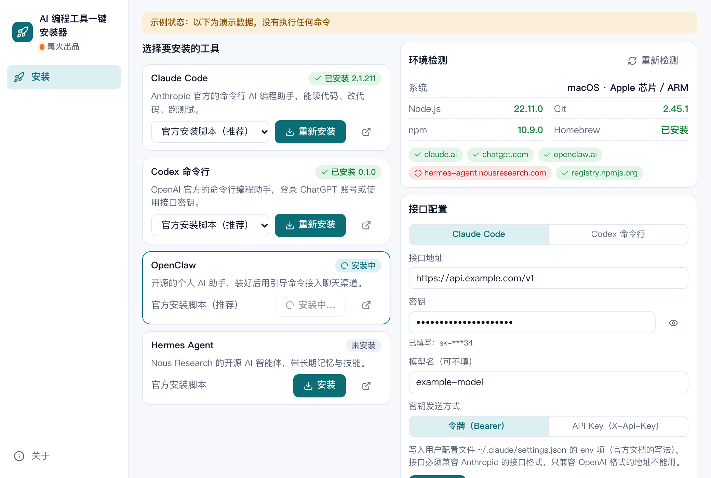

# AI 编程工具一键安装器

> 篝火出品 · 收录于篝火 App 应用区

双击装好 Claude Code、Codex 等 AI 编程工具，自填接口自动配好，安装报错有引导



## 下载

到 [Releases](https://github.com/campfire-code/ai-coding-installer/releases/latest) 下载对应安装包：

| 电脑 | 文件 |
|---|---|
| Windows 10 / 11 | `ai-coding-installer_版本号_windows-x64-setup.exe` |
| Mac（Apple 芯片） | `ai-coding-installer_版本号_mac-arm64.dmg` |
| Mac（Intel 芯片） | `ai-coding-installer_版本号_mac-x64.dmg` |

第一次打开：
- **Windows**：如果弹出「Windows 已保护你的电脑」，点「更多信息」→「仍要运行」。
- **Mac**：如果提示「无法验证开发者」，打开「系统设置 → 隐私与安全性」，在下方点「仍要打开」。

## 怎么用

1. 打开后先看右上「环境检测」：系统、Node.js、Git、npm、Homebrew，以及各官方安装脚本地址能不能连上。缺东西会给出官方下载页。
2. 在左边选要装的工具和安装方式，点「安装」。命令的输出实时显示在底部「实时输出」里，密钥会自动打码。
3. 装完会自动再检测一次并显示版本。若找不到命令，按提示关闭终端重新打开。
4. 要用自己的接口：在「接口配置」选 Claude Code 或 Codex，填接口地址、密钥、模型名，点「写入配置」。写入前会把原文件备份为 `原文件名.bak-时间`。
5. 安装被拦时，底部会出现引导卡片（共识别 15 类情况）。遇到没见过的报错，可点「用大模型翻译成大白话」，需先在「设置」里填好大模型的接口地址、密钥和模型名；发出去的报错文字会先打码。

### 收录的工具与官方来源（2026-10-27 核实）

| 工具 | 安装方式（官方文档原文命令） | 接口配置 |
|---|---|---|
| Claude Code | 安装脚本 / Homebrew / WinGet / npm（需 Node.js 22 以上） | 写 `~/.claude/settings.json` 的 `env`：`ANTHROPIC_BASE_URL`、`ANTHROPIC_AUTH_TOKEN` 或 `ANTHROPIC_API_KEY`、`ANTHROPIC_MODEL`。接口必须兼容 Anthropic 格式 |
| Codex 命令行 | 安装脚本 / Homebrew / npm | 写 `~/.codex/config.toml` 的 `model_provider`，密钥放环境变量 `CAMPFIRE_CODEX_API_KEY`（macOS 写入 `~/.zshrc`，Windows 用 `setx`）。接口须支持 responses 格式 |
| OpenClaw | 官方安装脚本 | 未核实官方配置文件写法，不代写；装好后运行 `openclaw onboard` |
| Hermes Agent | 官方安装脚本（Mac 仅支持 Apple 芯片） | 未核实自定义接口写法，不代写；装好后运行 `hermes model` |

### 安全说明

- 应用只能执行白名单里的命令，白名单写在 `src-tauri/capabilities/shell-unix.json` 与 `shell-windows.json`（由 `src/tool/commands.json` 生成，测试保证两者一致）。每条命令的参数都是写死的，只有 Windows 的 `setx` 允许填入密钥且受正则限制。
- 密钥只保存在本机：应用设置文件、你选择写入的工具配置文件、`~/.zshrc` 或用户环境变量。Windows 的 `setx` 会让密钥短暂出现在命令行参数里。
- 安装脚本来自各工具官方域名，本工具不下载、不改写它们的内容，请自行判断是否信任。

## 验收用例

1. 把 `samples/示例-已有的claude设置.json` 复制为 `~/.claude/settings.json`（先备份你自己的）。在「接口配置 → Claude Code」填 `https://api.example.com`、任意 8 位以上密钥、模型名 `example-model`，点「写入配置」。应得到：`settings.json` 里保留 `theme` 与 `EXAMPLE_VAR`，新增 `ANTHROPIC_BASE_URL`、`ANTHROPIC_AUTH_TOKEN`、`ANTHROPIC_MODEL`；同目录出现 `settings.json.bak-…` 备份，内容是原来的文件。
2. 把 `~/.claude/settings.json` 改成不合法的 JSON（例如删掉一个括号）再点「写入配置」。应得到：提示「不是合法的 JSON」，文件没有被改动。
3. 切到 Codex 填同样内容写入。应得到：`~/.codex/config.toml` 顶部有 `model`、`model_provider = "campfire"`，末尾有 `[model_providers.campfire]`，文件里**没有**密钥；`~/.zshrc` 末尾多一段 `CAMPFIRE_CODEX_API_KEY`。
4. 断开网络点「重新检测」。应得到：各地址变红；点安装后底部出现「网络异常」卡片。
5. 点 Hermes Agent 的安装前确认芯片：Intel 版 Mac 应提示不支持，不会执行任何命令。
6. 「实时输出」里出现密钥（例如 `sk-` 开头）时应显示为 `sk-***`。
7. `samples/示例-安装报错.txt` 的每一行，对应的识别结果见 `src/tool/diagnose.test.ts` 的用例。

## 自己编译

需要 Node.js 22、pnpm、Rust。修改 `src/tool/commands.json` 后运行 `node scripts/gen-capabilities.mjs` 重新生成命令白名单。

```bash
pnpm install
pnpm test          # 单元测试
pnpm tauri dev     # 开发运行
pnpm tauri build   # 打包
```

界面框架在 `src/kit`（所有 campfire-code 工具共用），本工具的逻辑在 `src/tool`。

## 归属

本工具由**篝火**出品，是篝火 App 应用区收录的开源工具之一，由篝火（GitHub 组织 [campfire-code](https://github.com/campfire-code)）维护与更新。全部工具的目录见 [toolkit-hub](https://github.com/campfire-code/toolkit-hub)。

## 许可证

MIT，版权方为篝火（campfire-code）。
